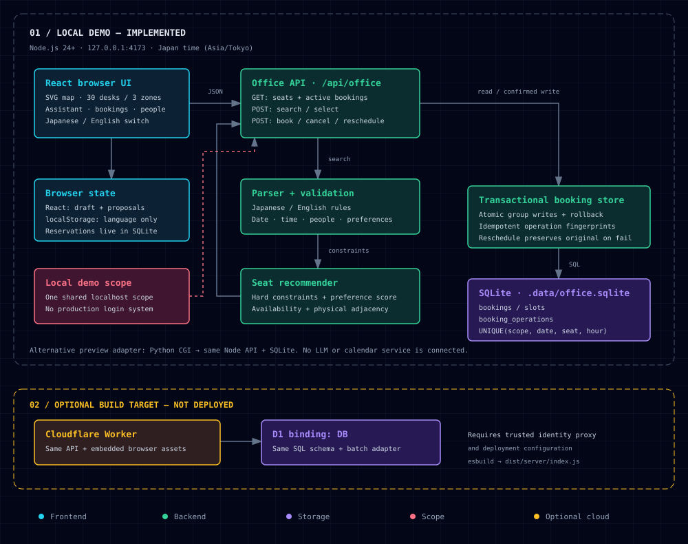

# NEST — Office Agent Demo

[日本語](README.md) | **English**

Describe where and when you want to work, see desk recommendations on an office map, and confirm a real booking. The fictional 30-desk office demonstrates individual bookings, adjacent team desks, rescheduling, cancellation and conflict recovery.

Japanese is the default. Use **日本語 / English** in the top bar to switch languages. The choice survives reloads and updates the map, people, booking results, errors and existing assistant responses. User messages keep their original wording.

> This is a **Japanese/English rule-based assistant**, with no LLM connected. Bookings are persisted in SQLite. It is an independent prototype inspired by workplace management products and is not affiliated with Colorkrew.

## Run locally

Requires **Node.js 24+** and npm. No API key is needed.

```bash
npm install
npm run build
npm start
```

Open [http://127.0.0.1:4173](http://127.0.0.1:4173). On macOS, double-click `start-demo.command` after building.

```bash
npm run dev   # rebuild and start after editing
npm run build
npm test
```

The server binds to loopback only. Bookings are stored in `.data/office.sqlite`, which is excluded from Git. Override `PORT` or `NEST_DB_PATH` if needed. Browsers connected to the same local server share one demo booking space.

## Use cases

| Use case | Example | Result |
| --- | --- | --- |
| Explore the office | Filter by area, date, time or desk ID | Inspect matching desks on the map |
| Book an individual desk | “Find a window desk with a monitor tomorrow morning” | Review and confirm an available option |
| Seat a team together | “Book 3 adjacent desks with monitors, preferably by a window” | Keep required constraints and suggest connected desks in one cluster |
| Sit near a colleague | “Find a quiet desk near Tanaka” | Rank seats using their booking during the selected time |
| Recover from a conflict | Enable the conflict toggle in Demo settings | Roll back the group attempt and suggest alternatives |
| Reschedule | My bookings → Reschedule → “Change to tomorrow afternoon” | Release old slots only after the replacement succeeds |
| Cancel | My bookings → Cancel booking | Remove the reservation and release its slots |
| Switch languages | Select English or 日本語 in the top bar | Translate the interface, results and people |

[Detailed use cases and screenshot gallery](docs/USE_CASES.en.md) / [日本語](docs/USE_CASES.ja.md)

## Capture screenshots

```bash
npx playwright-core install chromium
npm run screenshots
```

The script drives the real UI against a **temporary SQLite database and dedicated local server**. It checks booking, reload persistence, rescheduling, cancellation, conflict recovery and language switching. It never changes your normal demo bookings. After all checks pass, it saves 13 images in `docs/screenshots/`, inserts them in the use-case documents, and records capture metadata in `capture-manifest.json`.

Set `NEST_BROWSER_PATH` to use a specific Chrome executable, or `NEST_SCREENSHOT_PORT` to change the capture server port. GitHub Actions runs the same checks and uploads the images as the `use-case-screenshots` artifact. It does not automatically commit images.

**Current capture status:** 13 real UI screenshots are available in the [gallery](docs/USE_CASES.en.md).

## Architecture



[Interactive HTML/export version](docs/architecture.html) · [SVG](docs/architecture.svg) · [PNG](docs/architecture.png)

The diagram uses the requested [Cocoon-AI/architecture-diagram-generator](https://github.com/Cocoon-AI/architecture-diagram-generator) HTML template and design system. Open the HTML locally to export PNG or PDF; export dependencies load from a CDN. Its [MIT license](docs/third-party/architecture-diagram-generator.LICENSE) is included.

| Layer | Implementation | Responsibility |
| --- | --- | --- |
| UI | React, TypeScript, SVG, Lucide | Map, assistant, bookings, people, language switch |
| Localization | `lib/i18n.mjs` | Japanese/English copy, dates and display names |
| API | `lib/api.ts`, `server.mjs` | Search, select, book, reschedule and cancel |
| Rules and recommendations | `lib/requests.mjs`, `lib/office.mjs` | Parse constraints, validate requests, rank available connected seats |
| Persistence | `lib/store.mjs`, `local-db.mjs` | SQLite transactions and idempotent operations |
| Build | esbuild | Browser bundle, Node API and optional Worker output |

The flow is `search → proposal → confirm → book`. Searching does not book a desk. Confirmation rechecks availability, and the database primary key on `(scope, date, seat, hour)` prevents overlapping allocations. Group writes are atomic. Rescheduling preserves the original booking if the replacement fails. Operation IDs and request fingerprints prevent duplicate submissions and replaying an old change over a newer one.

`dist/server/index.js` is an optional Worker / D1 target. **It has not been deployed.** It requires a `DB` binding, schema migration and a trusted authentication proxy. Do not expose a deployment that lets callers freely supply `oai-authenticated-user-id`. Local builds work without `.openai/hosting.json`.

## API

| Method | Request | Purpose |
| --- | --- | --- |
| GET | `/api/office?date=YYYY-MM-DD` | Read desks, occupancy and active bookings |
| POST | `{ "action": "search", "text": "...", "context": {} }` | Parse a request and return options |
| POST | `{ "action": "select", "request": { ... } }` | Validate a map-selected desk |
| POST | `{ "action": "book", "request": { ... }, "proposalId": "..." }` | Confirm an option |
| POST | `book` with `replaceId` | Reschedule an existing booking |
| POST | `{ "action": "cancel", "id": "..." }` | Cancel a booking |

Booking requests contain `date`, `start`, `end`, `count`, `seatIds`, `names` and preferences. API error codes are language-neutral and translated by the UI.

## Scope and limits

- 30 desks, 3 areas and 8 fictional colleagues. Seed bookings repeat for each date. Meeting rooms are display-only.
- Book for 1–6 people, from today through 90 days ahead, in whole-hour slots between 08:00 and 20:00 Japan time.
- Required windows remain a hard constraint. “Preferably by a window” is a soft preference. Window clusters have two desks, so three adjacent desks require another area.
- Proximity ranks desks by distance to a colleague who has a booking during the requested time; it does not enforce a maximum distance.
- The parser does not understand arbitrary wording, recurring schedules or minute-level times. Review the proposal before confirming.
- Chat history is held only in the current page. Bookings and the language preference survive reloads.
- No real office system, calendar, notifications, QR check-in or corporate identity integration is connected.

## Connecting an LLM later

An LLM with structured output can replace the parsing stage and produce the same booking request shape. Keep server validation, availability calculations, explicit confirmation and database transactions. Future capabilities could clarify ambiguous requirements, suggest times from participants’ calendars, and release desks when people are absent. These integrations are not implemented in this demo.
