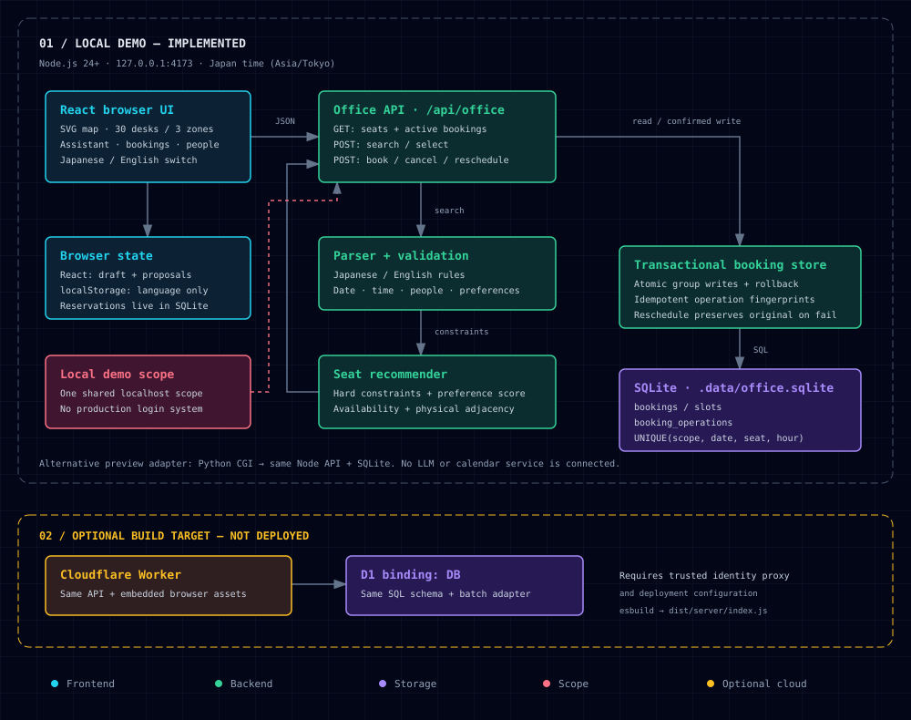

# となり / NEST — Office Agent Demo

**日本語** | [English](README.en.md)

自然言語で希望を伝えると、オフィスマップ上に座席候補を表示し、確認後に予約を保存するデモです。30席の架空オフィスで、個人予約、チームの隣接席、変更・キャンセル、競合時の代替案を体験できます。

日本語が初期表示です。右上の **日本語 / English** から切り替えられ、選択した言語は再読み込み後も保持されます。マップ、メンバー名、予約結果、エラー、アシスタントの既存回答も切り替わります。入力した文章は原文を保持します。

> 現在のアシスタントは **日本語・英語のルールベース解析器** です。LLMには接続していません。予約はSQLiteに実際に保存されます。Colorkrewの製品を参考にした独立した試作であり、同社とは関係ありません。

## 起動

Node.js **24以上** とnpmが必要です。APIキーは不要です。

```bash
npm install
npm run build
npm start
```

[http://127.0.0.1:4173](http://127.0.0.1:4173) を開きます。macOSでは、ビルド後に `start-demo.command` をダブルクリックして起動することもできます。

```bash
# コード変更後に再ビルドして起動
npm run dev

# ビルド済みAPIを含めて検証
npm run build
npm test
```

開発サーバーはループバックにのみバインドします。既定の予約データは `.data/office.sqlite` に保存され、Gitには含まれません。`PORT` でポート、`NEST_DB_PATH` でデータベースを変更できます。ローカル版は同じサーバーを利用するブラウザー間で予約データを共有する単一デモスペースです。

## 主なUse Case

| Use Case | 操作例 | 結果 |
| --- | --- | --- |
| 空席を探す | エリア、日付、時間、座席番号で絞り込み | 対象の座席をマップ上で確認 |
| 個人で予約 | 「明日の午前、窓際でモニター付きの席を予約したい」 | 候補を確認して予約 |
| チームで予約 | 「3人で隣同士の席を予約。モニター必須、できれば窓際」 | 必須条件を守り、同じテーブル内の接続した席を提案 |
| 同僚の近くに座る | 「田中さんの近くで、静かな席を探して」 | 対象時間帯の予約位置を参考に候補を順位付け |
| 競合に対応 | デモ設定で「次の予約で競合を再現する」を有効化 | 部分的なグループ予約を残さず、別の候補を提示 |
| 予約を変更 | 自分の予約 → 変更 →「明日の午後に変更」 | 新しい予約が成功してから元の席を解放 |
| 予約をキャンセル | 自分の予約 → 予約をキャンセル | 予約を削除し、座席を解放 |
| 英語に切り替える | 右上でEnglishを選択 | 画面・結果・メンバー名を英語で表示 |

[操作手順とスクリーンショットの一覧](docs/USE_CASES.ja.md) / [English use cases](docs/USE_CASES.en.md)

## スクリーンショットを生成

```bash
npx playwright-core install chromium
npm run screenshots
```

スクリプトは**一時SQLiteデータベースと専用サーバー**を使い、実際のUIで予約・再読み込み・変更・キャンセル・競合回復・言語切り替えを操作します。既存のデモ予約を変更せず、13枚の画像を `docs/screenshots/` に保存します。撮影が全件成功すると、Use Case文書に画像を挿入し、撮影日時・ブラウザー情報を `capture-manifest.json` に記録します。

`NEST_BROWSER_PATH` でChrome実行ファイル、`NEST_SCREENSHOT_PORT` で撮影用サーバーのポートを指定できます。GitHub Actionsでも同じ検証を行い、画像を `use-case-screenshots` アーティファクトに保存します。Actionsは画像を自動コミットしません。

**現時点の撮影状況:** 13枚の実操作スクリーンショットを保存しました。[ギャラリー](docs/USE_CASES.ja.md)をご覧ください。

## アーキテクチャ



[HTML版を開く](docs/architecture.html) · [SVG版](docs/architecture.svg) · [PNG版](docs/architecture.png)

構成図は指定の [Cocoon-AI/architecture-diagram-generator](https://github.com/Cocoon-AI/architecture-diagram-generator) のHTMLテンプレートとデザイン規約を使用しています。HTMLをブラウザーで開くとPNG・PDFへのエクスポートができます。エクスポート機能にはCDN接続が必要です。[テンプレートのMITライセンス](docs/third-party/architecture-diagram-generator.LICENSE)を同梱しています。

| レイヤー | 実装 | 役割 |
| --- | --- | --- |
| UI | React、TypeScript、SVG、Lucide | 座席図、アシスタント、予約一覧、言語切り替え |
| 翻訳 | `lib/i18n.mjs` | 日本語・英語の表示文言、日付、人物名 |
| API | `lib/api.ts`、`server.mjs` | 検索、候補選択、予約、変更、キャンセル |
| 解析・候補選択 | `lib/requests.mjs`、`lib/office.mjs` | 自然言語の条件抽出、検証、空席・隣接判定 |
| 永続化 | `lib/store.mjs`、`local-db.mjs` | SQLiteのトランザクションと冪等処理 |
| ビルド | esbuild | ブラウザー用バンドル、Node API、任意のWorker出力 |

検索は予約を確定しません。`search → proposal → confirm → book` の順に進みます。予約確定時には最新の空席を再確認し、DBの `(scope, date, seat, hour)` 主キーでも重複を防ぎます。グループ予約は一括で保存し、失敗すると全体をロールバックします。変更処理もトランザクション内で行い、失敗時には元の予約を保持します。操作IDとリクエスト内容を記録し、同じ操作の再送で予約を増やしたり、古い変更を再適用したりしないようにしています。

`dist/server/index.js` はWorker / D1向けの任意ビルドです。**クラウドへの配備は未完了**です。利用には `DB` バインディング、SQLマイグレーション、信頼できる認証プロキシが必要です。`oai-authenticated-user-id` を外部から自由に指定できる構成では公開しないでください。ローカル起動に `.openai/hosting.json` は不要です。

## API

| メソッド | リクエスト | 用途 |
| --- | --- | --- |
| GET | `/api/office?date=YYYY-MM-DD` | 座席、占有状況、有効な予約を取得 |
| POST | `{ "action": "search", "text": "...", "context": {} }` | 条件の解析と候補提示 |
| POST | `{ "action": "select", "request": { ... } }` | マップで選択した席の検証 |
| POST | `{ "action": "book", "request": { ... }, "proposalId": "..." }` | 候補の予約を確定 |
| POST | `book` に `replaceId` を追加 | 既存予約を変更 |
| POST | `{ "action": "cancel", "id": "..." }` | 予約をキャンセル |

予約の `request` は `date`、`start`、`end`、`count`、`seatIds`、`names` と希望条件を持ちます。APIはロケール非依存のエラーコードを返し、UIで翻訳します。

## 範囲と制約

- 30席、3エリア、8人の架空メンバー。初期予約は日付ごとに繰り返されます。会議室はマップ表示のみです。
- 一度に1〜6人、今日から90日先まで、08:00〜20:00の正時単位で予約できます。
- 「窓際は必須」は必須条件です。「できれば窓際」は希望条件として扱います。窓際エリアは2席単位なので、3人の隣接席は他エリアを提案します。
- 「近く」は対象時間帯に予約のあるメンバーとの距離を順位付けに使います。厳密な距離上限の指定には対応していません。
- ルールベースのため、任意の言い回し、毎週などの繰り返し予約、分単位の時刻には対応していません。候補の日時・人数・席を確認してから確定してください。
- チャット履歴はページ内のみ保持します。予約と表示言語は再読み込み後も残ります。
- 本物のオフィス管理、カレンダー、通知、QRチェックイン、社内認証には接続していません。

## LLMを接続するなら

`parseRequest` の前段に構造化出力のLLMを接続し、日付・人数・希望条件を同じリクエスト形式へ変換する構成が適しています。検証、空席計算、ユーザーの最終確認、DBトランザクションは現行の実装を維持できます。将来の拡張候補には、曖昧な条件の聞き返し、参加者の予定を使った日時提案、欠席時の座席解放があります。いずれもこのデモには未実装です。
