# Use cases and screenshots

[README](../README.en.md) | [日本語](USE_CASES.ja.md)

<!-- capture-status:start -->
Captured from real UI interactions on 2026-11-22T11:07:15.003Z, using Chromium 153.0.8010.12 and an isolated temporary SQLite database.
<!-- capture-status:end -->

## 01. Explore available desks

Start in Japanese and choose a date, time and area. The map shows available desks, occupied seats and fictional colleagues.

<!-- capture:01-ja-office-map.png:start -->
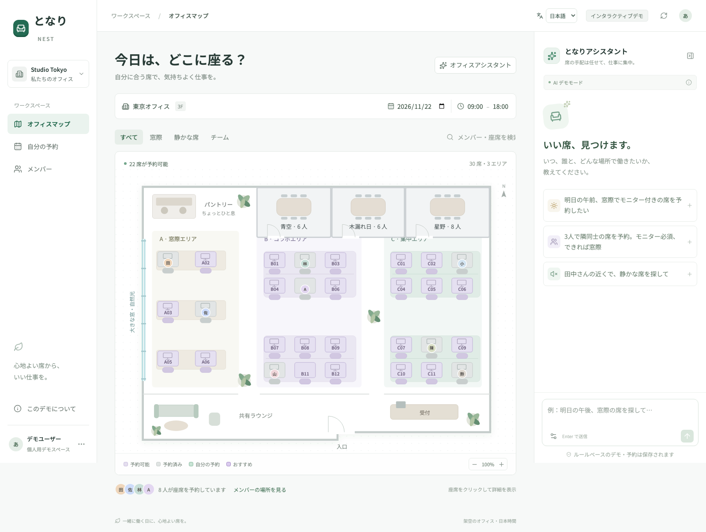
<!-- capture:01-ja-office-map.png:end -->

## 02. Book from the map

Select available desk A02 and choose Book this desk. Review the option before confirming; selecting a desk alone does not save a booking.

<!-- capture:02-ja-map-selection.png:start -->
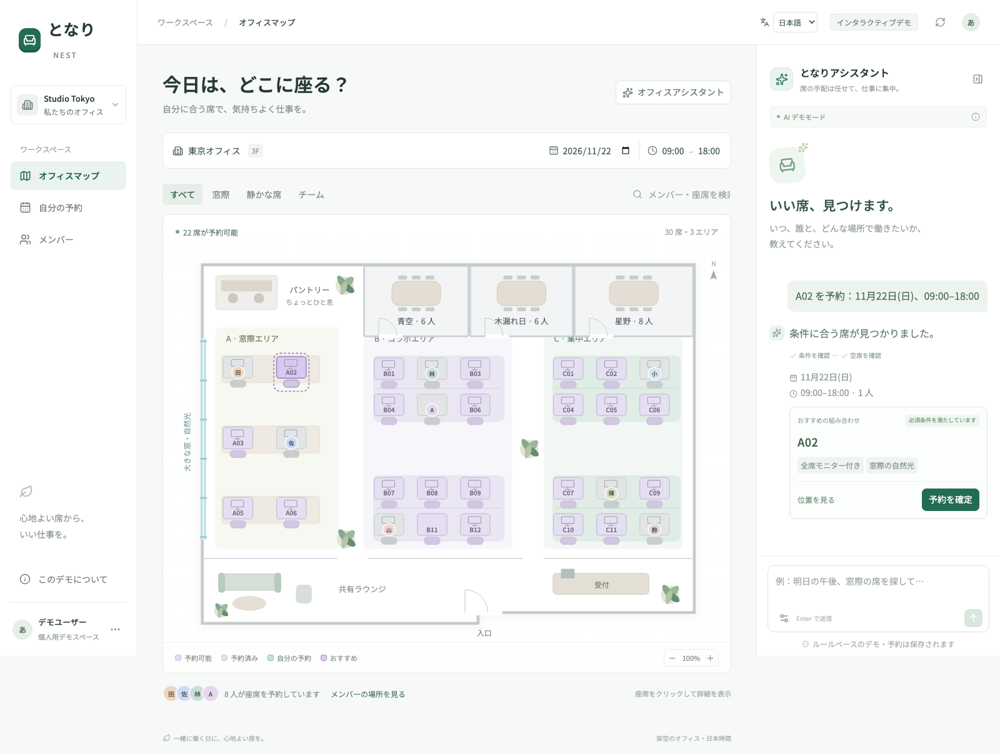
<!-- capture:02-ja-map-selection.png:end -->

## 03. Persist across reloads

Confirm a booking, reload the page, and open My bookings to verify the saved desk and time.

<!-- capture:03-ja-saved-booking.png:start -->
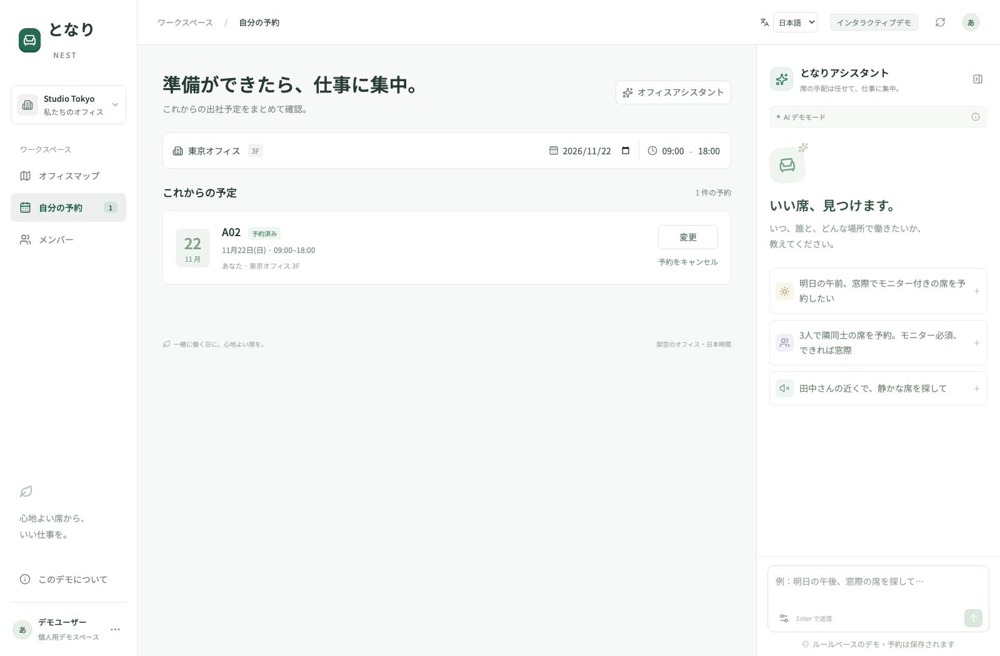
<!-- capture:03-ja-saved-booking.png:end -->

## 04. Reschedule a booking

Choose Reschedule and enter “Change to tomorrow afternoon”. Confirm the option and verify the updated 13:00–18:00 slot.

<!-- capture:04-ja-reschedule.png:start -->
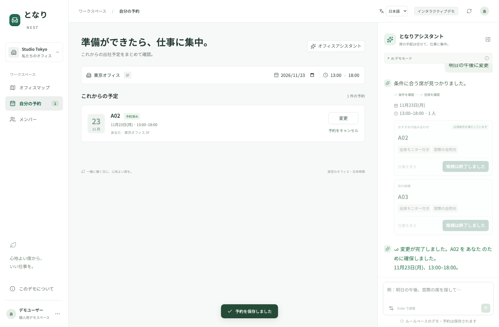
<!-- capture:04-ja-reschedule.png:end -->

## 05. Cancel a booking

Cancel the reservation from My bookings. The booking disappears and the slots become available again.

<!-- capture:05-ja-cancellation.png:start -->
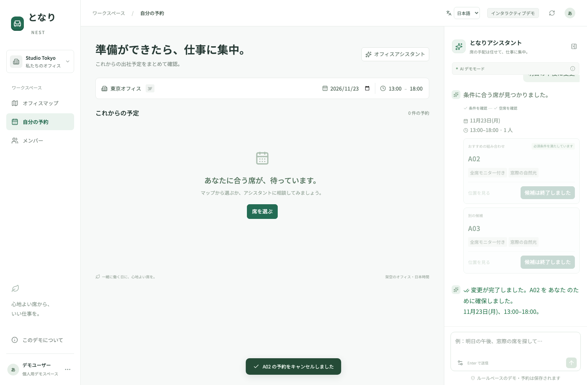
<!-- capture:05-ja-cancellation.png:end -->

## 06. Find adjacent team desks

Ask for three adjacent desks next Wednesday, 09:00–18:00, for yourself, Tanaka and Sato, with monitors required and windows preferred. The proposal preserves required constraints when a window group is unavailable.

<!-- capture:06-ja-team-proposal.png:start -->
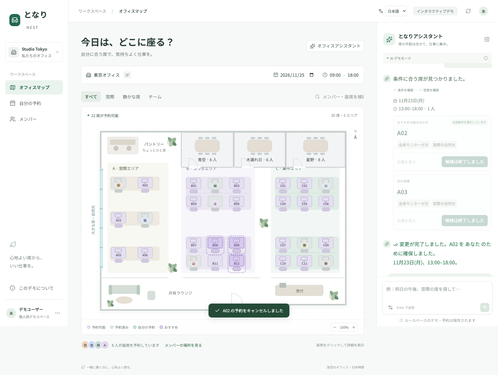
<!-- capture:06-ja-team-proposal.png:end -->

## 07. Recover from a conflict

Enable conflict simulation and confirm. The demo inserts a conflicting reservation, rolls back the group attempt and offers new available options.

<!-- capture:07-ja-conflict-recovery.png:start -->
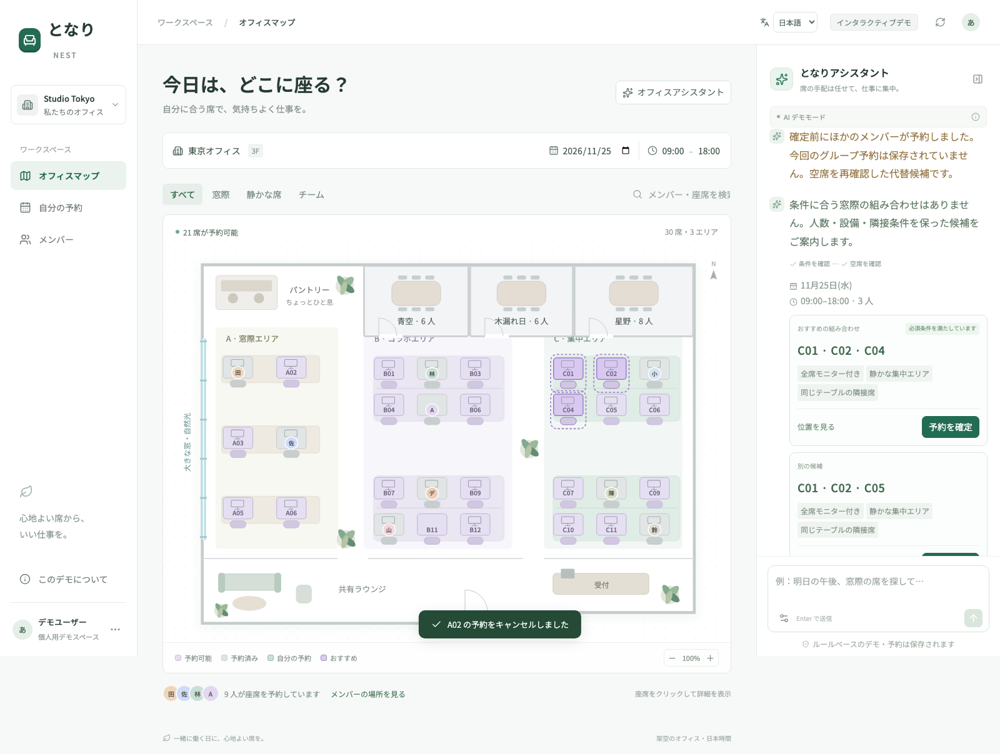
<!-- capture:07-ja-conflict-recovery.png:end -->

## 08. Confirm the whole group

Confirm a replacement option and verify that all three desks and participant names are stored in one booking.

<!-- capture:08-ja-team-booking.png:start -->
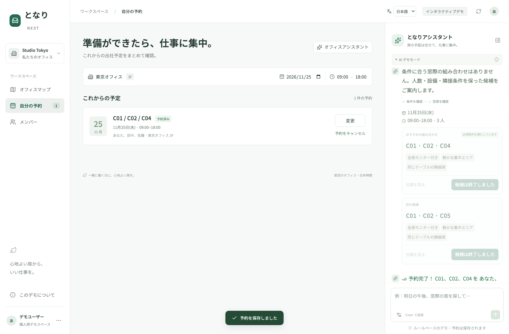
<!-- capture:08-ja-team-booking.png:end -->

## 09. Switch languages

Switch to English. Booking labels and names change, and the language preference persists after reload.

<!-- capture:09-en-bookings.png:start -->
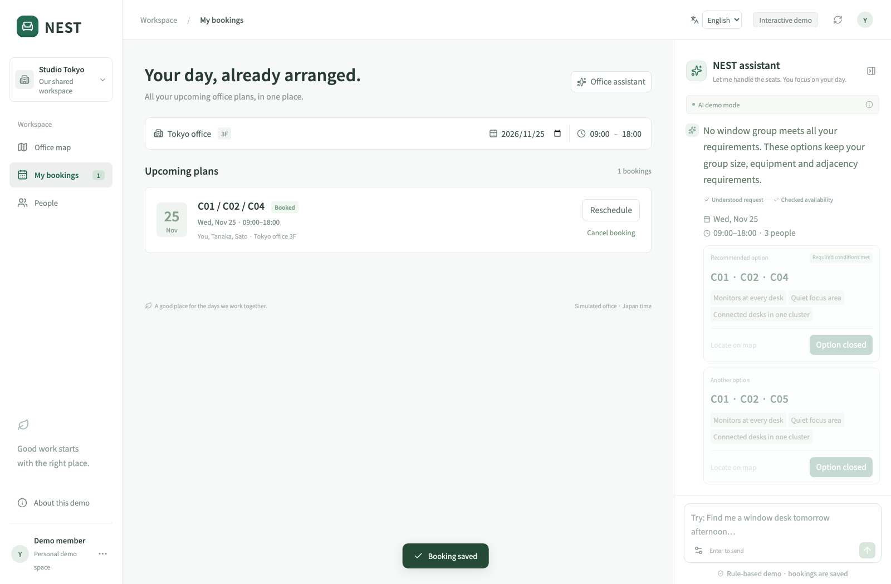
<!-- capture:09-en-bookings.png:end -->

## 10. Request a desk in English

Enter “Find a window desk with a monitor tomorrow morning” and review the English recommendation and schedule.

<!-- capture:10-en-natural-language.png:start -->
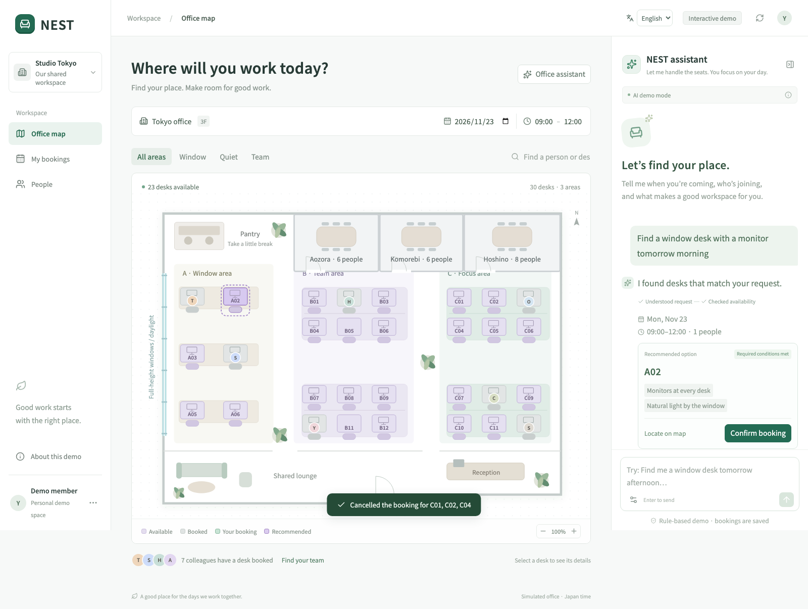
<!-- capture:10-en-natural-language.png:end -->

## 11. Locate teammates

Open People to see locations for the selected time. Show on map focuses the corresponding desk.

<!-- capture:11-en-people.png:start -->
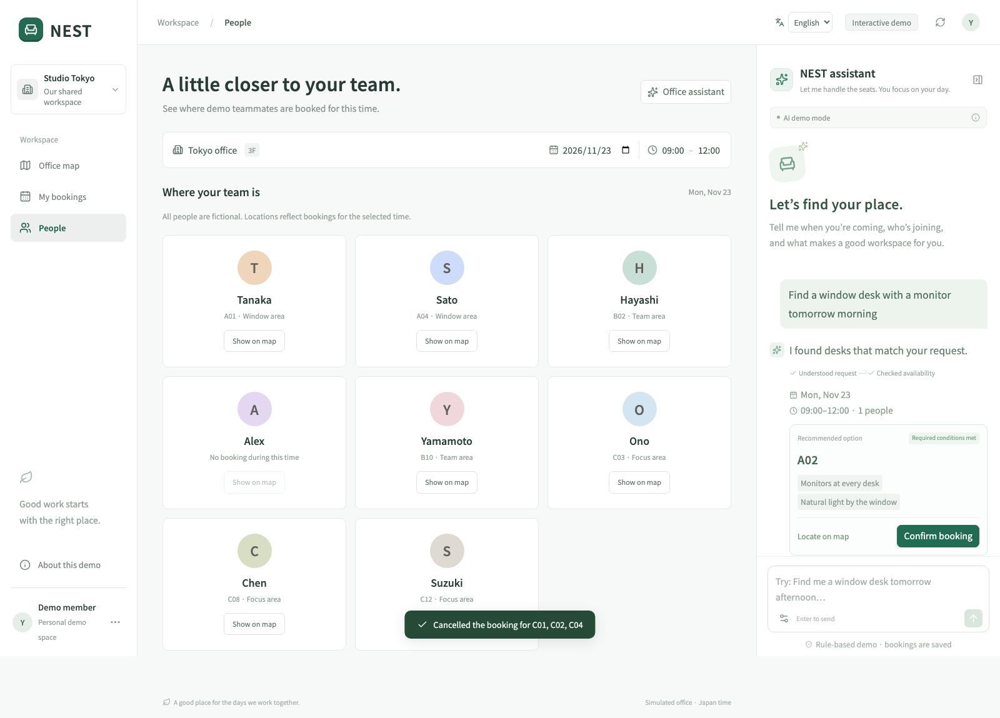
<!-- capture:11-en-people.png:end -->

## 12. Use a mobile viewport

At a 390px viewport, scroll the office map horizontally and use the assistant below it.

<!-- capture:12-en-mobile.png:start -->
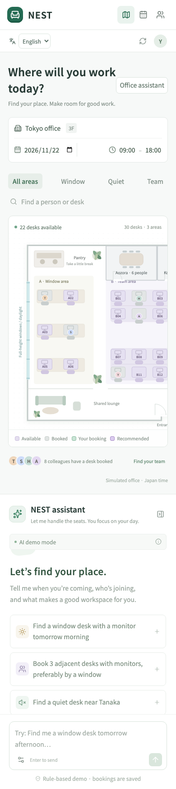
<!-- capture:12-en-mobile.png:end -->

## 13. Inspect the architecture

The Cocoon AI template shows the implemented local flow separately from the undeployed cloud build target.

<!-- capture:13-architecture.png:start -->
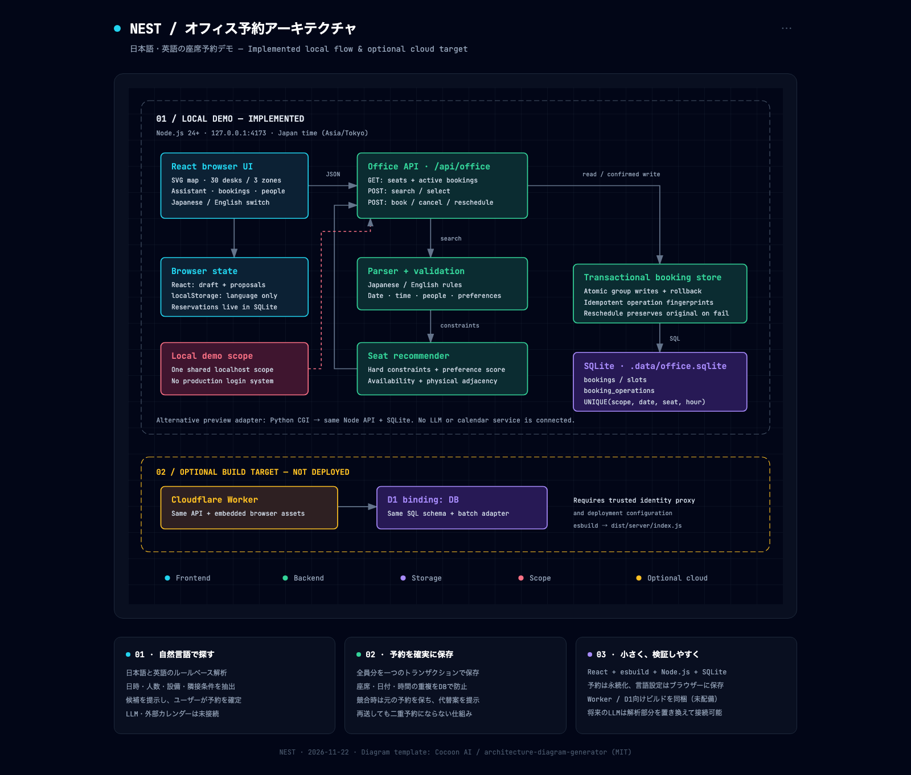
<!-- capture:13-architecture.png:end -->
