# Use Caseと操作画面

[README](../README.md) | [English](USE_CASES.en.md)

<!-- capture-status:start -->
実際のUIを操作して撮影しました。撮影日時: 2026-11-22T11:07:15.003Z。ブラウザー: 153.0.8010.12。テスト専用の一時SQLiteを使用しています。
<!-- capture-status:end -->

## 01. オフィスマップで空席を探す

日本語で起動し、日付・時間・エリアを選びます。空席数、予約済みの席、メンバーの位置が同じマップに表示されます。

<!-- capture:01-ja-office-map.png:start -->
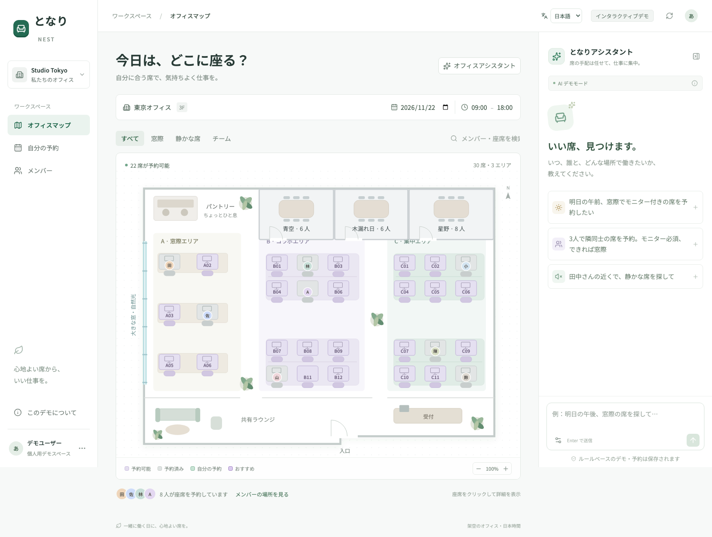
<!-- capture:01-ja-office-map.png:end -->

## 02. マップから個人予約

空席A02をクリックし、「この席を予約」から候補を確認します。この時点では保存されず、「予約を確定」で確定します。

<!-- capture:02-ja-map-selection.png:start -->
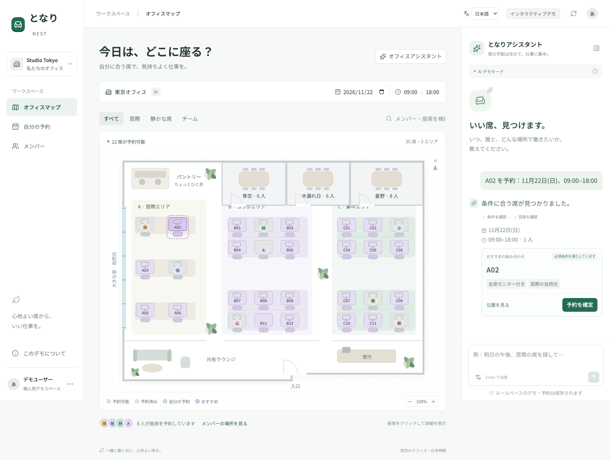
<!-- capture:02-ja-map-selection.png:end -->

## 03. 保存と再読み込み

予約を確定後に画面を再読み込みし、「自分の予約」で保存された座席と時間を確認します。

<!-- capture:03-ja-saved-booking.png:start -->
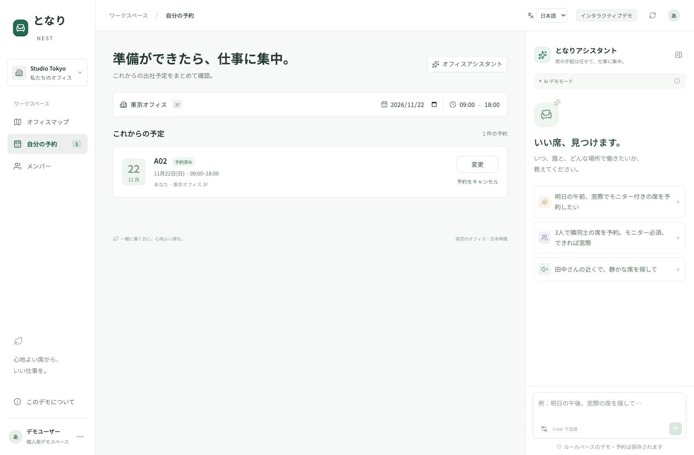
<!-- capture:03-ja-saved-booking.png:end -->

## 04. 予約を安全に変更

「自分の予約」→「変更」から「明日の午後に変更」と入力します。候補を確定し、13:00〜18:00への変更を確認します。

<!-- capture:04-ja-reschedule.png:start -->
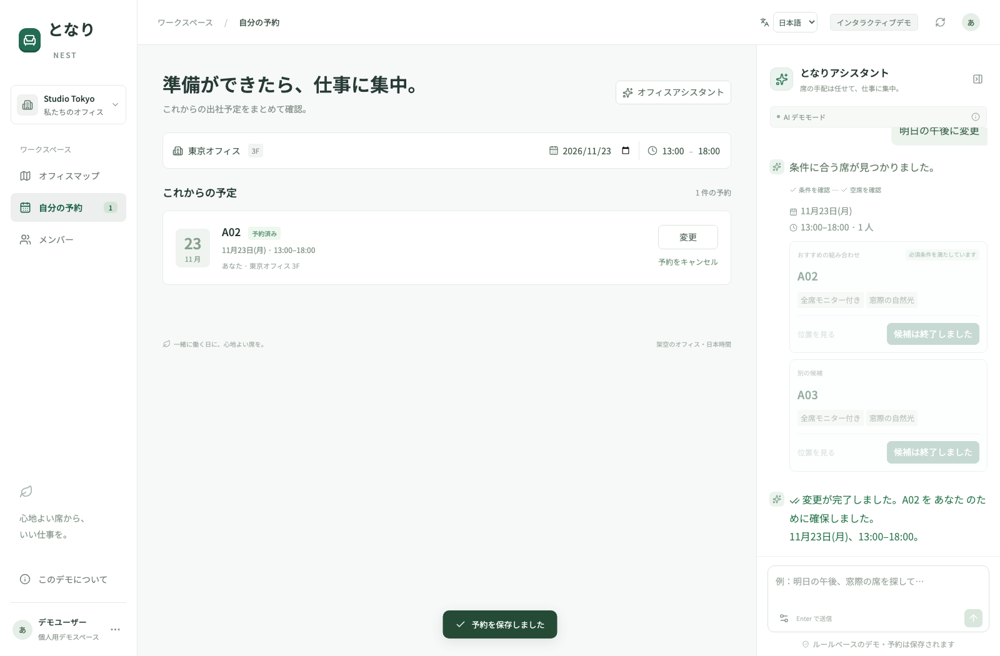
<!-- capture:04-ja-reschedule.png:end -->

## 05. 予約をキャンセル

予約一覧の「予約をキャンセル」を押し、予約がなくなったことと座席が解放されたことを確認します。

<!-- capture:05-ja-cancellation.png:start -->
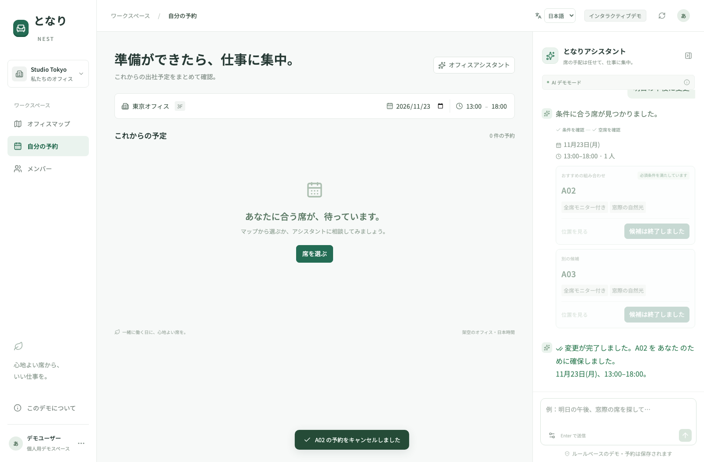
<!-- capture:05-ja-cancellation.png:end -->

## 06. 自然言語で3人の隣接席を探す

「来週水曜日9時から18時、私と田中さんと佐藤さんの3人で隣同士の席を予約。モニター必須、できれば窓際。」と入力。窓際に3人が並べない場合も、人数・モニター・隣接条件は維持します。

<!-- capture:06-ja-team-proposal.png:start -->
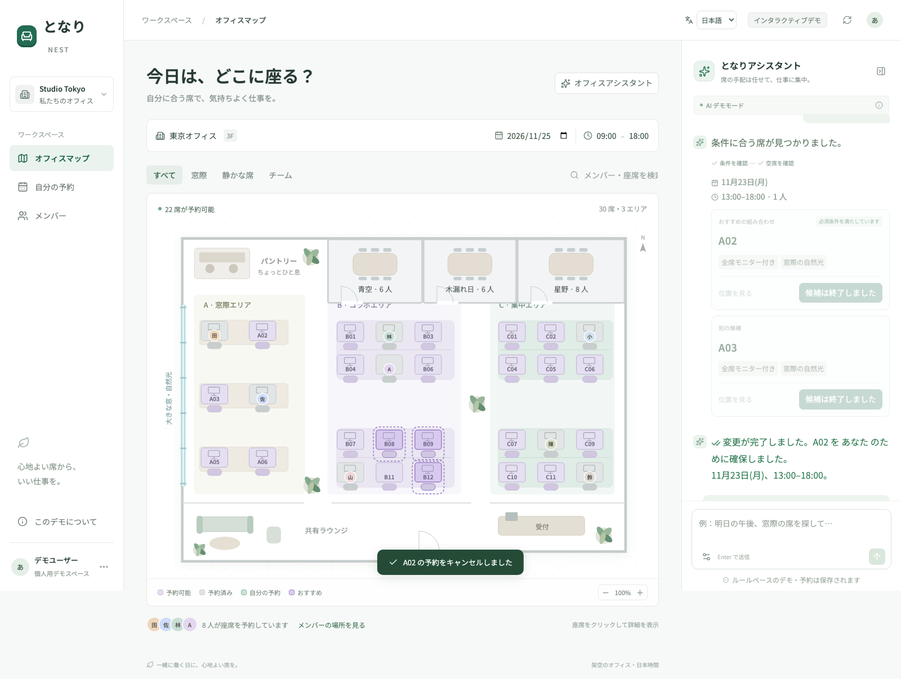
<!-- capture:06-ja-team-proposal.png:end -->

## 07. 予約競合から復帰

デモ設定で競合を有効にして確定します。別のデモメンバーによる予約を実際に挿入し、グループ予約の失敗後に代替案を提示します。

<!-- capture:07-ja-conflict-recovery.png:start -->
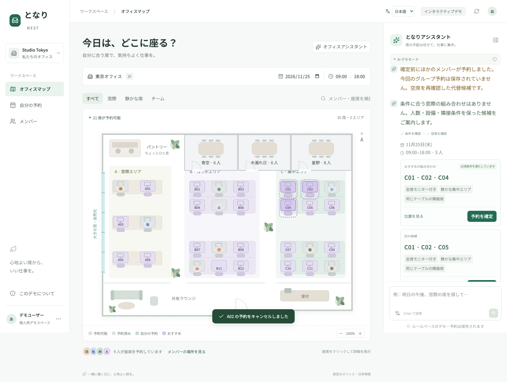
<!-- capture:07-ja-conflict-recovery.png:end -->

## 08. グループ全員の予約を確定

競合後の代替案を確定し、3席と全員の名前が一つの予約として保存されたことを確認します。

<!-- capture:08-ja-team-booking.png:start -->
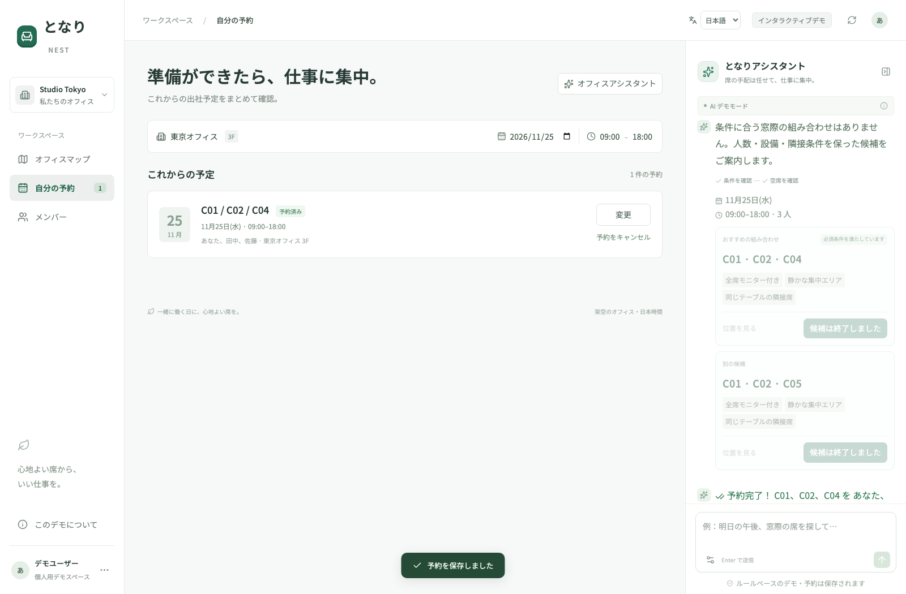
<!-- capture:08-ja-team-booking.png:end -->

## 09. 言語切り替え

Englishへ切り替えると、予約一覧と名前が英語表記になります。再読み込み後も言語設定を維持します。

<!-- capture:09-en-bookings.png:start -->
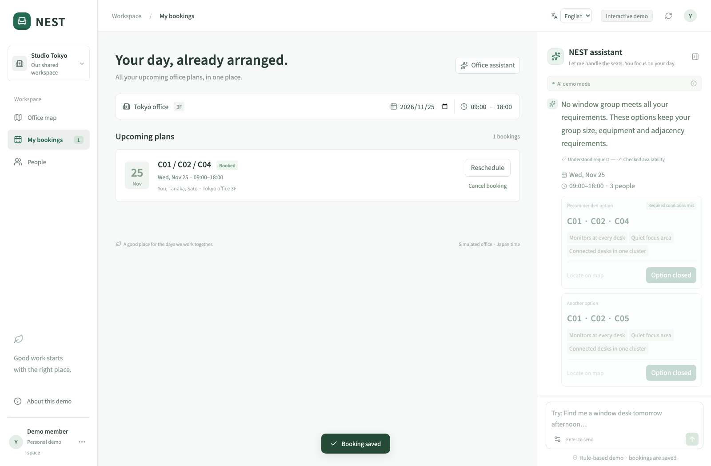
<!-- capture:09-en-bookings.png:end -->

## 10. 英語で予約を相談

“Find a window desk with a monitor tomorrow morning” と入力し、英語の候補と日時を確認します。

<!-- capture:10-en-natural-language.png:start -->
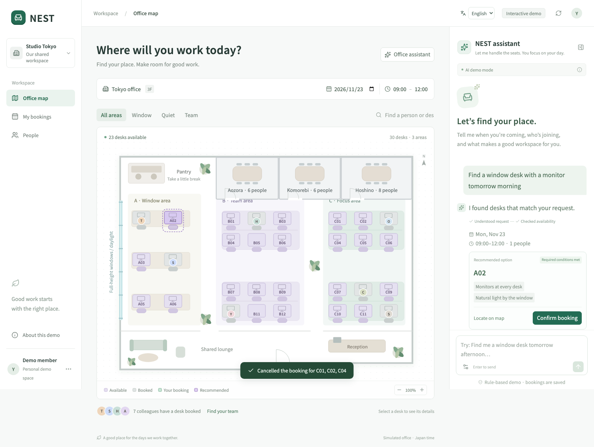
<!-- capture:10-en-natural-language.png:end -->

## 11. メンバーの居場所を確認

メンバー一覧で選択時間帯の予約位置を確認します。「マップで見る」から該当席に移動できます。

<!-- capture:11-en-people.png:start -->
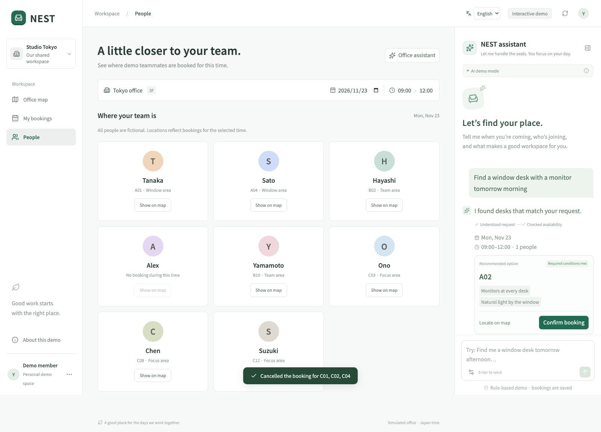
<!-- capture:11-en-people.png:end -->

## 12. モバイルで利用

幅390pxで表示し、マップを横にスクロールしながら、下部のアシスタントで予約を操作します。

<!-- capture:12-en-mobile.png:start -->
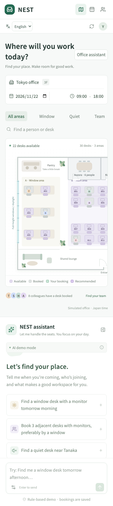
<!-- capture:12-en-mobile.png:end -->

## 13. プロジェクト構成を確認

Cocoon AIのテンプレートを使った構成図。ローカルの実装と未配備のクラウド出力を区別しています。

<!-- capture:13-architecture.png:start -->
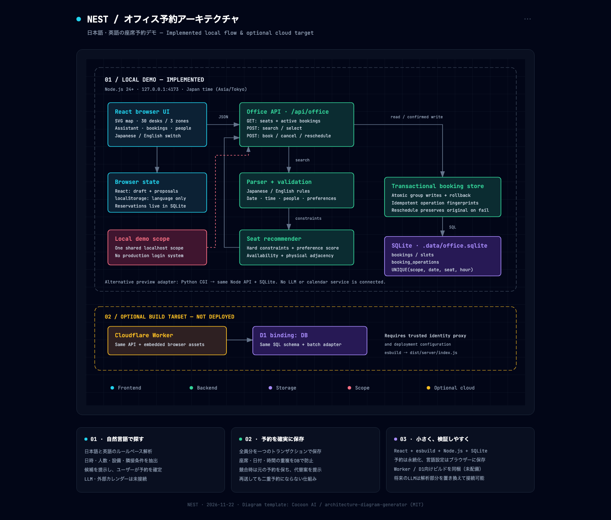
<!-- capture:13-architecture.png:end -->
